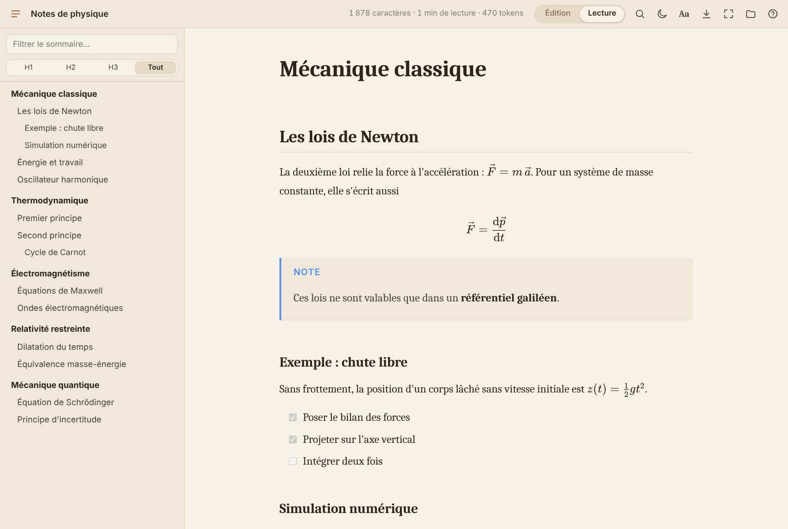
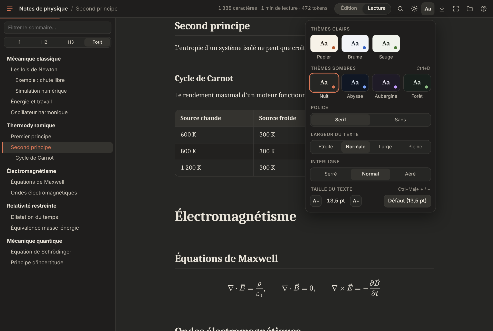

<p align="center"></p>

<h1 align="center">MDReader (MDR)</h1>

<p align="center">Lecteur Markdown portable et ultra-rapide pour Windows, avec éditeur intégré — un seul <code>.exe</code> de 2 Mo, sans installation.</p>

<p align="center"><a href="https://github.com/joshsssn/MDReader/releases/latest"><b>⬇ Télécharger MDReader.exe</b></a> &nbsp;·&nbsp; <a href="#extension-vs-code"><b>🧩 Extension VS Code</b></a> &nbsp;·&nbsp; <a href="https://joshsssn.github.io/MDReader/"><b>📱 Version web / mobile</b></a></p>



## Pourquoi

Conçu pour lire de **très gros fichiers Markdown** (testé sur 1,5 million de caractères, ~1 500 titres, 2 000 formules) sans latence :

| Mesure (fichier de 1,5 M caractères) | Temps |
|---|---|
| Parsing + mise en page | ~0,5 s |
| Recherche Ctrl+F sur tout le document | ~10 ms |

Le Markdown est converti en Rust ([pulldown-cmark](https://github.com/pulldown-cmark/pulldown-cmark)), affiché par WebView2 (le moteur de Chrome, déjà présent dans Windows 10/11), et seule la partie visible de la page est mise en page.

## Fonctionnalités

- **Sommaire** recréé à partir des titres : filtre, niveaux H1 / H2 / H3, section courante surlignée
- **Maths** (KaTeX intégré, hors ligne) : `$…$`, `$$…$$`, blocs ```` ```math ````
- **Tableaux**, notes de bas de page, listes de tâches, encadrés GitHub (`> [!NOTE]`…), front matter ignoré
- **Recherche** Ctrl+F instantanée, insensible à la casse et aux accents
- **Zoom comme Chrome** : pincement deux doigts = loupe sur la zone, Ctrl+molette = zoom de page par paliers
- **7 thèmes** (Papier, Brume, Sauge, Nuit, Abysse, Aubergine, Forêt), **mode nuit** Ctrl+D
- Police serif / sans, **taille du texte en pt**, largeur de colonne, interligne
- **Plein écran** F11 (barre masquée, réapparaît en haut de l'écran)
- **Export PDF** direct et **export HTML autonome** (un seul fichier, avec sommaire, recherche et thèmes)
- Reprise de la position de lecture, fichiers récents, rechargement automatique quand le fichier change
- **Éditeur intégré** pour les `.md` et les `.txt` (application Windows) : voir ci-dessous. En lecture, rien n'est jamais modifié



## Éditeur

Un interrupteur **Lecture / Édition** dans la barre (`Ctrl+E`) ouvre le document dans l'éditeur ; `Ctrl+N` crée un nouveau document.

- **Markdown, vue « Rendu »** : édition directe du document mis en forme, avec une barre d'outils (styles de titre, gras, italique, souligné, barré, code, lien, image, listes à puces, numérotées et à cocher, citation, encadrés, bloc de code, formule, tableau, séparateur, note de bas de page).
- **La syntaxe Markdown est reconnue à la frappe** : `### ` devient un titre, `- ` ou `1. ` une liste, `[ ] ` une case à cocher, `> ` une citation, ```` ``` ```` puis Entrée un bloc de code, `$$` puis Entrée une formule, `---` un séparateur, `| a | b |` un tableau ; `**gras**`, `*italique*`, `~~barré~~`, `` `code` ``, `$x^2$` et `[texte](lien)` sont mis en forme dès le caractère fermant.
- **Éditeur d'équations** : un clic sur une formule (ou le bouton ∑) ouvre un panneau avec aperçu en direct et palettes de symboles par onglets (exposants, fractions et racines, sommes et intégrales, lettres grecques, opérateurs, flèches, parenthèses et matrices, accents, fonctions, récents). Un clic insère la structure, `Tab` passe au champ suivant, le LaTeX reste modifiable à la main.
- **Markdown, vue « Source »** (second interrupteur **Rendu / Source**, `Ctrl+Maj+E`) : le texte brut, pour retoucher la structure. La barre d'outils y insère la syntaxe correspondante.
- **Fichiers `.txt`** : éditeur de texte brut, sans mise en forme.
- **Enregistrement** explicite (`Ctrl+S`, bouton de la barre), **Enregistrer sous** (`Ctrl+Maj+S`), annuler / rétablir (`Ctrl+Z` / `Ctrl+Y`). Un point signale les modifications non enregistrées, et une confirmation est demandée avant de fermer ou de changer de fichier.
- **Fidélité** : seuls les blocs réellement modifiés sont réécrits. Le reste du fichier est conservé à l'octet près (mise en page du Markdown, fins de ligne, front matter, HTML).
- Copier depuis l'éditeur donne du Markdown ; coller du Markdown l'insère mis en forme.

L'éditeur reste fluide sur de très gros fichiers (testé sur 1,6 million de caractères) : comme le lecteur, il ne met en page que la partie visible.

## Utilisation

Télécharger `MDReader.exe` depuis les [Releases](https://github.com/joshsssn/MDReader/releases) et le lancer. Pour ouvrir un fichier : le glisser sur l'exe ou dans la fenêtre, `Ctrl+O`, ou « Ouvrir avec » dans l'Explorateur.

Les réglages sont stockés dans un dossier `MDR-data` créé à côté de l'exe (supprimable à tout moment).

Ligne de commande :

```
MDReader.exe fichier.md                      ouvrir
MDReader.exe --export fichier.md sortie.html export HTML
MDReader.exe --pdf fichier.md sortie.pdf     export PDF
```

Prérequis : Windows 10 ou 11 avec le runtime WebView2 (installé par défaut sur Windows 11).

## Extension VS Code

Le même moteur de rendu (Rust, compilé en WebAssembly) et la même interface sont aussi disponibles comme extension VS Code, dans [`vscode/`](vscode). Deux façons d'utiliser MDReader, au choix :

| | Application Windows | Extension VS Code |
|---|---|---|
| Installation | aucune, un `.exe` portable | fichier `.vsix` |
| Plateformes | Windows 10 / 11 | partout où VS Code tourne |
| Export PDF / HTML, plein écran, zoom loupe | ✅ | — (VS Code a ses propres zoom et plein écran) |
| Éditeur intégré | ✅ | — (VS Code est déjà un éditeur) |
| Sommaire, recherche, maths, thèmes, rechargement auto | ✅ | ✅ |

Installer l'extension :

1. Télécharger `mdreader-1.0.0.vsix` depuis les [Releases](https://github.com/joshsssn/MDReader/releases/latest).
2. Dans VS Code : `Ctrl+Maj+P` → **Extensions: Install from VSIX…**, puis sélectionner le fichier. Ou en ligne de commande :

```
code --install-extension mdreader-1.0.0.vsix
```

3. Clic droit sur un `.md` → **Ouvrir avec… → MDReader**.

Pour en faire l'éditeur par défaut :

```json
"workbench.editorAssociations": { "*.md": "mdreader.viewer" }
```

Générer le `.vsix` depuis les sources (Rust avec la cible `wasm32-unknown-unknown`, et Node) :

```
rustup target add wasm32-unknown-unknown
cd vscode
npm run package
```

## Version web et mobile (PWA)

**<https://joshsssn.github.io/MDReader/>** : MDReader dans le navigateur, sans compte ni serveur. Le Markdown est converti **localement sur l'appareil** par le même moteur Rust (WebAssembly) : aucun fichier n'est transmis. Après la première visite, l'application fonctionne hors ligne.

Installation :

- **iPhone / iPad** : ouvrir le lien dans Safari, puis **Partager → Sur l'écran d'accueil**.
- **Android** : ouvrir le lien dans Chrome, puis menu ⋮ → **Installer l'application**.
- **Ordinateur** : Chrome ou Edge, icône d'installation dans la barre d'adresse.

Le bouton **Ouvrir** permet de choisir un `.md` (Fichiers, iCloud Drive, etc.). Les 15 derniers documents et la position de lecture sont conservés dans le navigateur, sur l'appareil.

Limites de la version web :

- pas de rechargement automatique lorsque le fichier change ;
- pas d'images locales (les images en `https://` s'affichent) ;
- pas d'export HTML ni d'éditeur ;
- « Exporter en PDF » ouvre l'impression du navigateur (iPhone : Partager → Enregistrer dans Fichiers).

Sur ordinateur, l'application installée via Chrome ou Edge peut être associée aux fichiers `.md`.

Construire la PWA depuis les sources :

```
rustup target add wasm32-unknown-unknown
cargo build --release --target wasm32-unknown-unknown --manifest-path vscode/wasm/Cargo.toml
node web/build.js        # résultat dans web/dist
```

Le déploiement sur GitHub Pages est automatique à chaque push (`.github/workflows/pages.yml`).

## Raccourcis

| Touche | Action |
|---|---|
| Ctrl+O | Ouvrir un fichier |
| Ctrl+F · F3 · Entrée / Maj+Entrée | Rechercher, suivant / précédent |
| Pincement deux doigts | Zoom loupe sur la zone |
| Ctrl+molette · Ctrl+ + / − · Ctrl+0 | Zoom de page |
| Ctrl+Maj+ + / − | Taille du texte |
| Ctrl+B | Sommaire |
| Ctrl+D | Mode nuit |
| F11 / Échap | Plein écran |
| Ctrl+P · Ctrl+Maj+P | Export PDF · Imprimer |
| Ctrl+Maj+H | Export HTML (aussi Ctrl+S en lecture, sans modification en attente) |
| Ctrl+E · Ctrl+Maj+E | Lecture / Édition · Rendu / Source |
| Ctrl+S · Ctrl+Maj+S | Enregistrer · Enregistrer sous |
| Ctrl+N | Nouveau document |
| Ctrl+Z · Ctrl+Y | Annuler · Rétablir |
| Ctrl+B · Ctrl+I · Ctrl+U · Ctrl+Maj+X · Ctrl+K | Gras · Italique · Souligné · Barré · Lien (en édition ; Ctrl+B affiche le sommaire en lecture) |
| F5 | Recharger |
| F1 | Aide |

## Compiler

```
cargo build --release
```

L'exe est produit dans `target/release/MDReader.exe` (CRT lié statiquement, icône intégrée via `build.rs`).

Structure : [`src/render.rs`](src/render.rs) (Markdown → HTML, sommaire), [`src/main.rs`](src/main.rs) (fenêtre, fichiers, exports), [`assets/`](assets) (interface : HTML, CSS, JS, KaTeX ; l'éditeur est dans `editor.js` et `editor.css`, chargés uniquement par l'application), [`vscode/`](vscode) (extension VS Code) et [`web/`](web) (PWA), qui réutilisent `render.rs` et `assets/`.

## Licence

[MIT](LICENSE) © 2026 Josh Soussan. KaTeX est distribué sous licence MIT.
