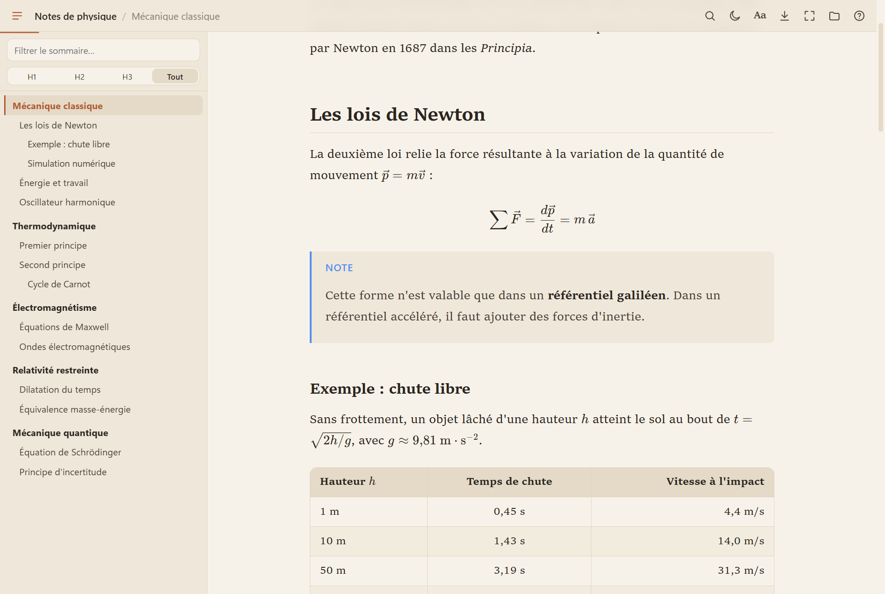
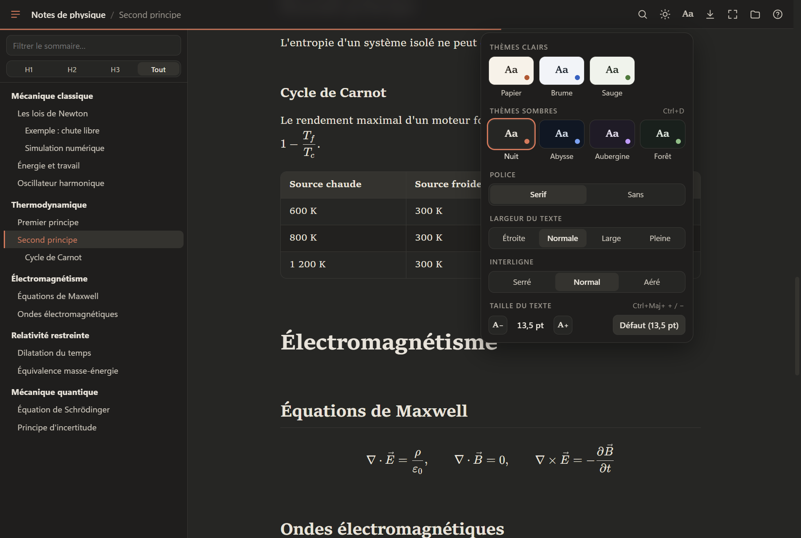

<p align="center"></p>

<h1 align="center">MDReader (MDR)</h1>

<p align="center">Lecteur Markdown portable et ultra-rapide pour Windows — un seul <code>.exe</code> de 2 Mo, sans installation.</p>

<p align="center"><a href="https://github.com/joshsssn/MDReader/releases/latest"><b>⬇ Télécharger MDReader.exe</b></a> &nbsp;·&nbsp; <a href="#extension-vs-code"><b>🧩 Extension VS Code</b></a></p>



## Pourquoi

Conçu pour lire de **très gros fichiers Markdown** (testé sur 1,5 million de caractères, ~1 500 titres, 2 000 formules) sans latence :

| Mesure (fichier de 1,5 M caractères) | Temps |
|---|---|
| Parsing + mise en page | ~0,5 s |
| Recherche Ctrl+F sur tout le document | ~10 ms |

Le Markdown est converti en Rust ([pulldown-cmark](https://github.com/pulldown-cmark/pulldown-cmark)), affiché par WebView2 (le moteur de Chrome, déjà présent dans Windows 10/11), et seule la partie visible de la page est mise en page.

## Fonctionnalités

- **Sommaire** recréé à partir des titres : filtre, niveaux H1 / H2 / H3, section courante surlignée
- **Maths** (KaTeX intégré, hors ligne) : `$…$`, `$$…$$`, blocs ```` ```math ````
- **Tableaux**, notes de bas de page, listes de tâches, encadrés GitHub (`> [!NOTE]`…), front matter ignoré
- **Recherche** Ctrl+F instantanée, insensible à la casse et aux accents
- **Zoom comme Chrome** : pincement deux doigts = loupe sur la zone, Ctrl+molette = zoom de page par paliers
- **7 thèmes** (Papier, Brume, Sauge, Nuit, Abysse, Aubergine, Forêt), **mode nuit** Ctrl+D
- Police serif / sans, **taille du texte en pt**, largeur de colonne, interligne
- **Plein écran** F11 (barre masquée, réapparaît en haut de l'écran)
- **Export PDF** direct et **export HTML autonome** (un seul fichier, avec sommaire, recherche et thèmes)
- Reprise de la position de lecture, fichiers récents, rechargement automatique quand le fichier change
- Lecture seule : rien n'est jamais modifié



## Utilisation

Télécharge `MDReader.exe` depuis les [Releases](https://github.com/joshsssn/MDReader/releases) et lance-le. Pour ouvrir un fichier : glisse un `.md` sur l'exe ou dans la fenêtre, Ctrl+O, ou « Ouvrir avec » dans l'Explorateur.

Les réglages sont stockés dans un dossier `MDR-data` créé à côté de l'exe (supprimable à tout moment).

Ligne de commande :

```
MDReader.exe fichier.md                      ouvrir
MDReader.exe --export fichier.md sortie.html export HTML
MDReader.exe --pdf fichier.md sortie.pdf     export PDF
```

Prérequis : Windows 10 ou 11 avec le runtime WebView2 (installé par défaut sur Windows 11).

## Extension VS Code

Le même moteur de rendu (Rust, compilé en WebAssembly) et la même interface sont aussi disponibles comme extension VS Code, dans [`vscode/`](vscode). Deux façons d'utiliser MDReader, au choix :

| | Application Windows | Extension VS Code |
|---|---|---|
| Installation | aucune, un `.exe` portable | fichier `.vsix` |
| Plateformes | Windows 10 / 11 | partout où VS Code tourne |
| Export PDF / HTML, plein écran, zoom loupe | ✅ | — (VS Code a ses propres zoom et plein écran) |
| Sommaire, recherche, maths, thèmes, rechargement auto | ✅ | ✅ |

Installer l'extension :

1. Télécharge `mdreader-1.0.0.vsix` dans les [Releases](https://github.com/joshsssn/MDReader/releases/latest).
2. Dans VS Code : `Ctrl+Maj+P` → **Extensions: Install from VSIX…** et choisis le fichier. Ou en ligne de commande :

```
code --install-extension mdreader-1.0.0.vsix
```

3. Clic droit sur un `.md` → **Ouvrir avec… → MDReader**.

Pour en faire l'éditeur par défaut :

```json
"workbench.editorAssociations": { "*.md": "mdreader.viewer" }
```

Pour générer le `.vsix` toi-même (Rust avec la cible `wasm32-unknown-unknown`, et Node) :

```
rustup target add wasm32-unknown-unknown
cd vscode
npm run package
```

## Raccourcis

| Touche | Action |
|---|---|
| Ctrl+O | Ouvrir un fichier |
| Ctrl+F · F3 · Entrée / Maj+Entrée | Rechercher, suivant / précédent |
| Pincement deux doigts | Zoom loupe sur la zone |
| Ctrl+molette · Ctrl+ + / − · Ctrl+0 | Zoom de page |
| Ctrl+Maj+ + / − | Taille du texte |
| Ctrl+B | Sommaire |
| Ctrl+D | Mode nuit |
| F11 / Échap | Plein écran |
| Ctrl+P · Ctrl+Maj+P | Export PDF · Imprimer |
| Ctrl+S | Export HTML |
| F5 | Recharger |
| F1 | Aide |

## Compiler

```
cargo build --release
```

L'exe est produit dans `target/release/MDReader.exe` (CRT lié statiquement, icône intégrée via `build.rs`).

Structure : [`src/render.rs`](src/render.rs) (Markdown → HTML, sommaire), [`src/main.rs`](src/main.rs) (fenêtre, fichiers, exports), [`assets/`](assets) (interface : HTML, CSS, JS, KaTeX), [`vscode/`](vscode) (extension VS Code, qui réutilise `render.rs` et `assets/`).

## Licence

[MIT](LICENSE) © 2026 Josh Soussan. KaTeX est distribué sous licence MIT.
